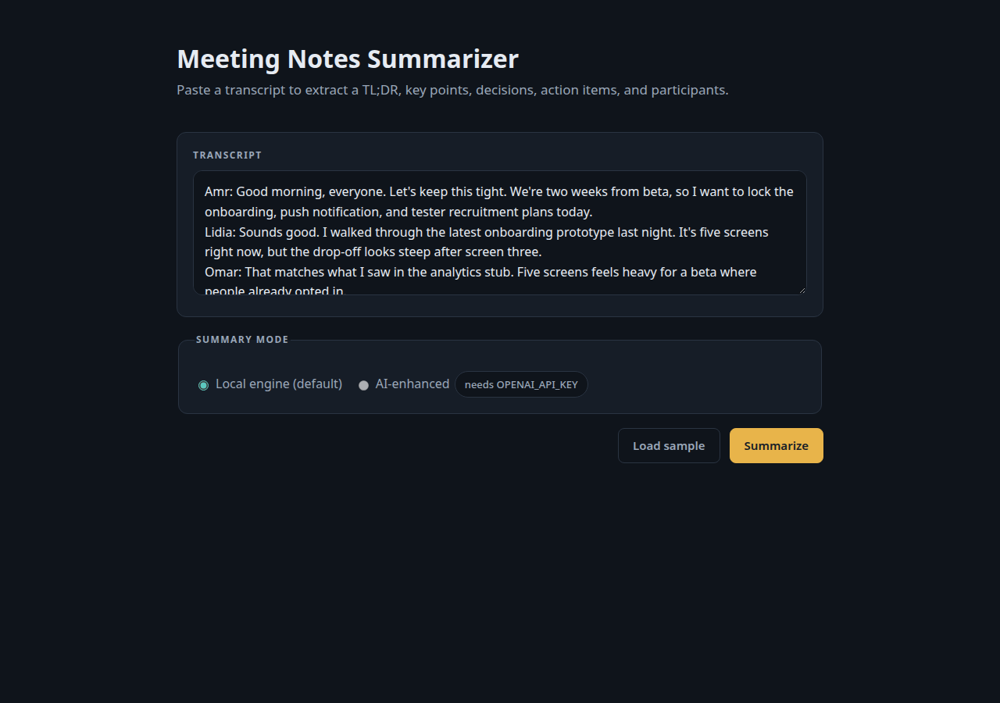
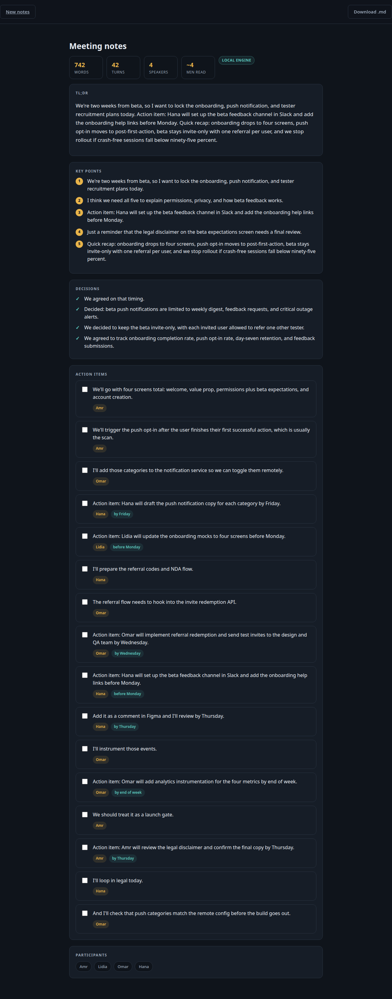

# Meeting Notes Summarizer

A Flask web app that turns a raw meeting transcript into structured notes. Paste in your transcript and get a TL;DR, key points, decisions, action items with detected owners and due dates, and a participant list. The fully local engine runs by default with no external calls. An optional AI-enhanced mode can use any OpenAI-compatible API by setting `OPENAI_API_KEY`, `OPENAI_BASE_URL`, and `OPENAI_MODEL`; if that mode fails for any reason, the app falls back to the local engine automatically.





## How it works

- **Extractive summarizer** — scores sentences by word frequency and position, then returns deduplicated key points.
- **Decision detector** — flags sentences containing decision cue phrases.
- **Action-item detector** — finds intent cues and imperative verbs, assigns an owner from explicit names or the current turn speaker with pronoun handling, and extracts due-date phrases.
- **Speaker parsing** — recognizes common transcript formats, including mid-line `"Name:"` labels.
- **Stats** — reports word count, turn count, number of speakers, and estimated reading time.

## Run it

```bash
python -m venv .venv
source .venv/bin/activate
pip install -r requirements.txt
python app.py
```

Then open http://127.0.0.1:5000 and click **Load sample**.

## Example output

Measured run of the bundled sample transcript (`data/sample_transcript.txt` — a fictional
product-team standup, synthetic demo data, not a real meeting):

- **742** words · **42** turns · **4** speakers (Amr, Lidia, Omar, Hana) · ~4 min read
- **5** key points, e.g. "Quick recap: onboarding drops to four screens, push opt-in moves
  to post-first-action, beta stays invite-only with one referral per user…"
- **4** decisions, e.g. "We decided to keep the beta invite-only, with each invited user
  allowed to refer one other tester."
- **16** action items with owners and due dates, e.g. "Action item: Hana will draft the
  push notification copy for each category by Friday." (owner: Hana, due: by Friday)

## API

- `POST /api/summarize` — JSON body `{"transcript": "...", "mode": "local"}` returns
  `{"mode": "local", "result": {...}}`; 400 on empty transcript.
- `POST /download` — returns the notes as a Markdown file (`meeting-notes.md`).

AI-enhanced mode (`"mode": "ai"`) requires your own API key — set `OPENAI_API_KEY`
(plus optional `OPENAI_BASE_URL` and `OPENAI_MODEL`). Local mode sends nothing anywhere.

## Tests

```bash
pytest tests/   # 37 tests, all green
```

Covers sentence splitting, speaker parsing (including mid-line `Name:` labels),
decision/action/owner/due-date detection, empty-input handling, Flask routes,
the JSON API, the Markdown download, LLM response parsing (mocked), and a
template/CSS class-consistency check.
